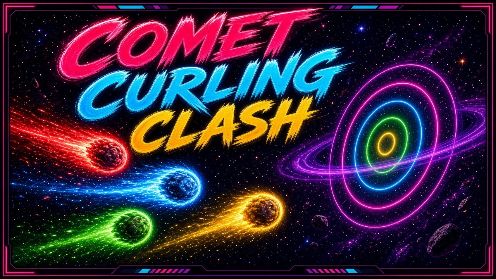

# Comet Curling Clash

Slide comets toward a gravity well and knock rival stones off the rings. Four pilots share one screen for a free-for-all of six ends. Empty seats fill with bots, so a single player can curl against the house.

## Launch

The game is plain HTML, canvas, and JavaScript. A tiny Python server hosts it on `127.0.0.1` port **8813** (or the next free port) and opens a browser.

| Platform | One-click launcher |
| --- | --- |
| macOS | Double-click `launch-mac.command` |
| Windows | Double-click `launch-windows.bat` |
| Linux | `./launch-linux.sh` |

The launchers look for Python 3 and print a short install hint if it is missing. From a terminal you can also run:

```bash
python3 server.py
```

Add `--no-browser` to serve without opening a window, or `--port 8813` to pick a port. `arcade.json` is the default port source.

## Controls

Aim with left and right. Hold **action** to run the power meter, then release to launch. During the slide, **secondary** spends one spin nudge and curves the comet. A connected gamepad overrides that seat's keyboard and can be plugged in mid-match. **Esc** or **Start** pauses. **M** mutes. **Enter** confirms menus.

| Seat | Move | Action | Secondary |
| --- | --- | --- | --- |
| P1 | W A S D | F | G |
| P2 | Arrow keys | / | . |
| P3 | I J K L | ; | ' |
| P4 | Numpad 8 4 5 6 | Numpad 0 | Numpad Enter |
| Gamepad | Left stick or D-pad | A (button 0) | B (button 1) |

Start on a pad pauses during play and confirms on the title and join screens. Bindings can be changed on the Controls screen and are stored in `localStorage`.

On the join screen, a seat's action key claims it for a human. Secondary toggles an empty seat between bot and off. At least one pilot is required.

## Rules

An end is one round. Active players throw in rotating order, P1 through P4, three comets each (twelve throws when every seat is filled). The sheet has a gravity well at the center of the house that gently bends moving comets inward. Stones collide and can knock each other away. A comet that leaves the rink is eliminated and scores nothing.

Each throw has a 15 second clock. If it expires, the comet launches on its own. While aiming or charging, a dotted line shows the first 20% of the estimated path.

Two power-ups appear on the sheet each end:

| Pickup | Effect |
| --- | --- |
| Nova (N) | The next collision hits harder |
| Anchor (A) | The comet gets heavier and is harder to shove aside |
| Drift (D) | Grants one extra spin nudge |

## Scoring

After every comet has been thrown and the sheet goes still:

| Placement | Points |
| --- | --- |
| Bullseye | 3 |
| Inner ring | 2 |
| Outer ring | 1 |
| Closest comet to the center | +2 |

Ties for closest each receive the bonus. The match is **6 ends** by default (1 to 9 in Settings). The highest total wins. A shared top score is a draw.

## arcade.json

`arcade.json` is the arcade launcher manifest: display name, id `cometcurlingclash`, icon, cover, one-click launch commands, the web entry `index.html`, 4 player seats, minimum 1 player, keyboard and gamepad input, version, and port 8813.

## Tests

Core rules run headlessly with Node's built-in test runner. No packages are installed.

```bash
node --test tests/
python3 tests/smoke_server.py
```

The Node suite covers movement and collision, ring scoring, end and match winners, elimination, spin and power-ups, seeded RNG, keyboard and gamepad mapping, and `arcade.json`. The Python smoke test starts `server.py` and requests `index.html`.

GitHub Actions runs both on push and pull request (`.github/workflows/test.yml`).

## License

[MIT](LICENSE)
